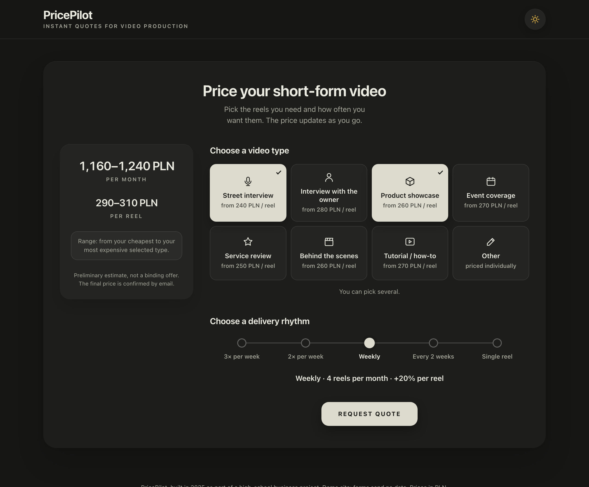
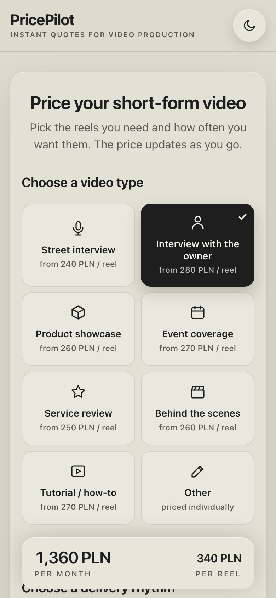

# PricePilot

**An instant, transparent quote calculator for a short-form video production service.**

**Live demo:** https://YOUR-USERNAME.github.io/YOUR-REPO/ *(placeholder: GitHub Pages link goes here)*

## The problem

Small service businesses often publish vague price ranges, for example 1,500–30,000 PLN for a video. Customers can't tell what they would actually pay, so they hesitate or never ask.

## The solution

The customer picks the kind of video they need and how often they want it, and gets a clear price per reel and per month in about 30 seconds. They can then send the request with their contact details. All prices live in one config object, so the business owner changes them in one place.

## Screenshots

| Light | Dark |
| --- | --- |
|  |  |



## How it works

```
price per reel = base price of the video type × delivery-rhythm multiplier   (rounded to the nearest 10 PLN)
monthly price  = price per reel × reels per month
```

| Delivery rhythm | Reels / month | Multiplier |
| --- | --- | --- |
| 3× per week | 12 | 1.0 |
| 2× per week | 8 | 1.1 |
| Weekly | 4 | 1.2 |
| Every 2 weeks | 2 | 1.3 |
| Single reel | 1 | 1.5 |

- Seven video types have a base price (240–280 PLN per reel). **Other** has no fixed price: the customer describes the video and the studio quotes it.
- Several types selected → the quote is shown as a range, from the cheapest to the most expensive type.
- **Other** together with standard types → the price covers the standard types; **Other** is quoted separately.
- After the quote, a short order step shows a summary and a contact form. This is a static demo: **the form sends nothing**, and the confirmation screen says so.

## Code

Plain HTML, CSS and JavaScript. No framework, no build step, no dependencies.

| File | Purpose |
| --- | --- |
| `index.html` | The calculator page |
| `pricing.js` | Price config and pricing logic as pure functions (no DOM), usable in the browser and in Node |
| `app.js` | Calculator UI: renders options from the config, shows the live quote, handles the order steps |
| `styles.css` | Light/dark themes, responsive layout |
| `pricing.test.js` | Tests for the pricing logic, no test framework |

Accessibility: native checkboxes and radio buttons (keyboard and screen-reader friendly), labelled form fields, visible focus states, and live announcement of price changes.

## Run locally

```bash
python3 -m http.server
```

Then open http://localhost:8000.

Run the tests (Node 18+):

```bash
node pricing.test.js
```

## Background

Built in 2025 as part of a high-school business project, alongside a business plan, market research and an investor pitch. In 2026 it was cleaned up for this portfolio: the calculator was moved to a single page, the pricing logic was extracted and tested, and the UI was translated to English (prices stay in Polish złoty). The visual design follows the original site.

## Next step (designed, not built)

- **LLM chatbot for custom requests.** When a request doesn't fit the presets (the "Other" option), a chatbot asks the customer the questions a quote needs and drafts a price for the owner to review.
- **Feedback loop.** The owner approves or rejects past quotes, and those decisions are used to improve future suggestions.

## License

[MIT](LICENSE)
